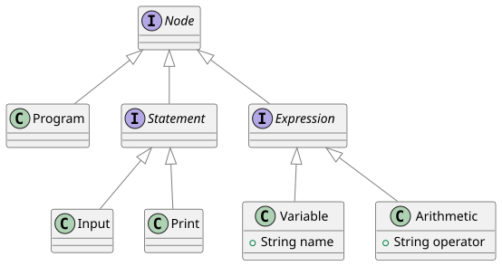
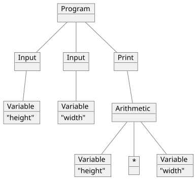

# Software Design Laboratory Class

## ✏️ Additional Instructions





```python
input height;
input width;
print height * width;
```




## 💻 Submission Instructions

To submit your solution:
- Open the terminal.
- Navigate to the folder where this `README.md` file is located.
- Run `git add -A`.
- Run `git commit -m "final code"`.
- Run `git push`.

**⚠️ IMPORTANT NOTE:** This repository will be **deleted** at the end of the course. Make sure to save any code you want to keep elsewhere.


## ✅ Exercise Solution

The solution to **this exercise** can be found in [this repository](https://github.com/org-raul-ds/10_Visitor_solution.git), which will be available during the next lab session (it is currently disabled, so the link will produce an error).

The solution to **last week's exercise** can be found in [this repository](https://github.com/org-raul-ds/09_Data_Structures_solution.git).
